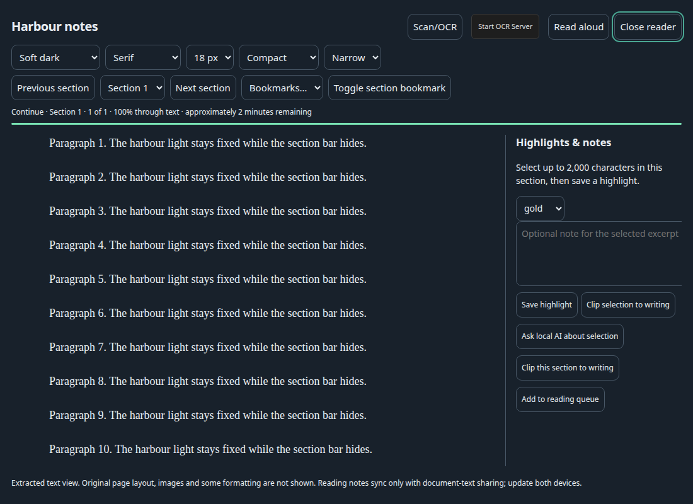
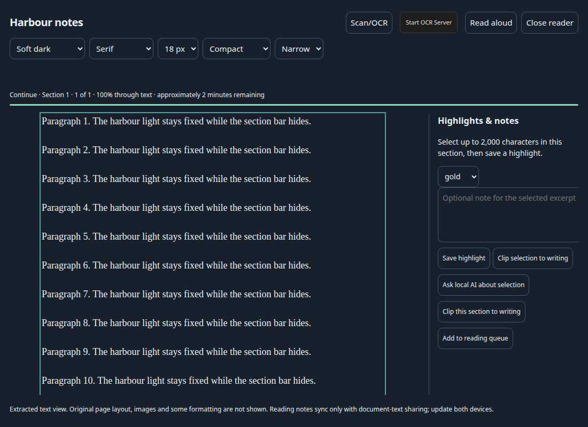
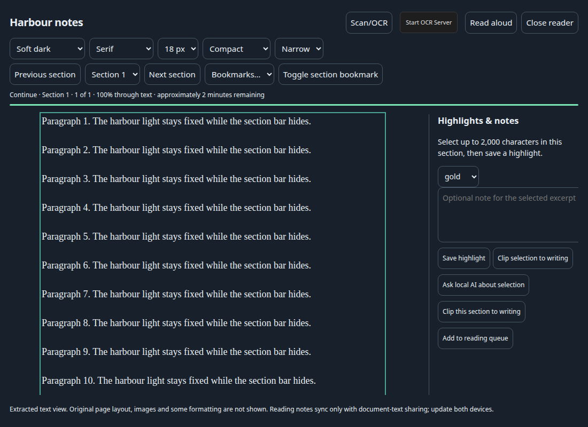

# Reader section bar

Browser fixture: `node scripts/app-qa/reader-nav.mjs` (headless Chrome, stubbed reader, not an installed app).

- Focusing the document text hides the section bar (`data-nav=collapsed`, `inert`).
- Ctrl+B (and Cmd+B) toggles it. Escape still closes the reader.
- The reading column stays put. Open and collapsed measurements: body `y=206`, page `y=214`, slot height `48.5`. A click after scrolling to `120` kept that scroll position.
- Button background color was unchanged between the open and restored states. No glass styles were added.

