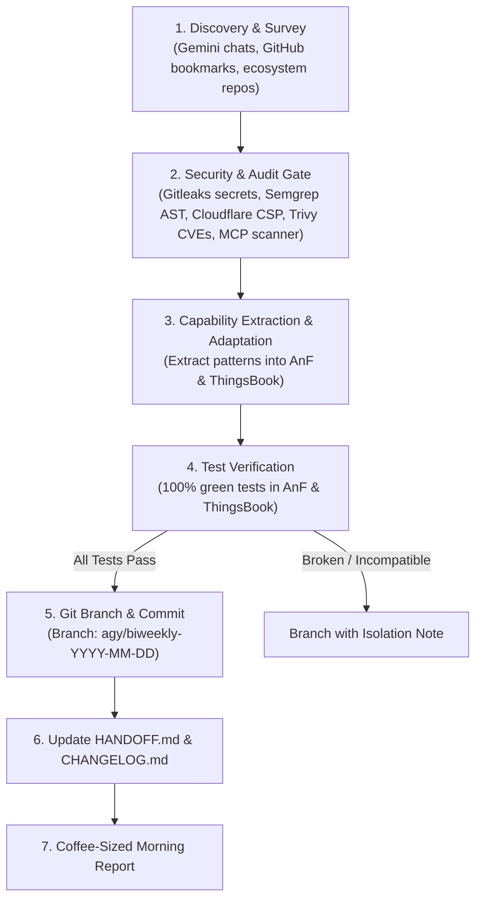

# Bi-Weekly Systems Intelligence & Security Runbook

This runbook defines the recurring, bi-weekly overnight audit and capability extraction cycle for **AnF** and **ThingsBook**. Every 14 days, the assistant autonomously surveys recent repositories, conducts security audits, adapts high-value capabilities, runs regression test suites, and delivers a concise morning briefing.

---

## The Bi-Weekly Cycle Workflow



---

## 1. Discovery & Survey Phase
* Check Gemini transcripts, GitHub stars, and community references for newly introduced repos.
* Baseline reference tools to include every cycle:
  - Security: `claude-code-security-review`, `gitleaks`, `semgrep`, `trivy`, `mcp-scanner`, `security-audit-skill`.
  - Media & Audio: `AntennaPod`, `Spotube`, `ViMusic`, `VoiceStudio`, `Audacity`.
  - Local AI & Compute: `kimi-k3-in-c`, `llama.cpp`, `sherpa-onnx`, `piper`, `minimind`.
  - Protocols & Storage: `localsend`, `paperclip`, `invidious`, `openclaude`.

---

## 2. Security & Integrity Audit
Execute the automated security test runners:
```bash
# In AnF:
cd windows
node scripts/test.mjs security-suite
node scripts/test.mjs mcp-guard

# In ThingsBook:
node work/run-tests.cjs security-suite
node work/run-tests.cjs mcp-guard
```
Verify:
1. **Zero Secret Leaks**: No raw API keys, tokens, or private keys committed or present in vaults/logs.
2. **Safe Webview/Tauri IPC**: No unsanitized `innerHTML`, unparameterized shell calls, or directory escapes.
3. **CSP Enforcement**: Webview CSP must prohibit `'unsafe-eval'` and unrestricted wildcard origins.
4. **MCP Tool Defense**: All registered agent tools validated against prompt injection and SSRF.

---

## 3. Capability Extraction & Adaptation
Targeted cross-pollination between apps:
* **AnF**: Kevo AI voice assistant, Audio Studio, Knowledge Vault, reading workspace.
* **ThingsBook**: Multi-format reader (CBZ, FB2, MOBI, DOCX, EPUB, PDF), audio narration, offline globe/atlas, personal voice engine.

---

## 4. Test Verification Contract
* **Rule**: Run tests after every single module extraction.
* Never commit non-passing code to the main branch or active integration branch.
* If a test fails due to an environmental limitation (e.g. missing native runtime), document it and isolate with a clean skip reason in `work/run-tests.cjs`.

---

## 5. Branching & Commit Discipline
* Branch naming: `agy/biweekly-YYYY-MM-DD`
* Commit message convention:
  - `feat(security): ...`
  - `feat(media): ...`
  - `feat(ai): ...`
  - `feat(storage): ...`
  - `docs(handoff): ...`
* Leave any incomplete or breaking exploratory work on a separate branch: `experiment/<feature>-YYYY-MM-DD` with an explicit reason note.

---

## 6. Morning Coffee-Sized Briefing Template
The final message must follow this structure:
1. **Critical Decisions / Blockers**: Questions requiring human judgment (at the very top).
2. **What Finished**: Bullet points with exact file links and what was accomplished.
3. **What Broke**: Any failures, skipped suites, or isolated branches.
4. **Where to Start**: 3 quick commands to verify and review before drinking coffee.

---

## How to Trigger the Automation

### Option A: Using the `/schedule` or `/automation` Slash Command
In the chat box, type `/schedule` or `/automation` and configure a recurring bi-weekly job:
* **Cron Expression**: `0 2 */14 * *` (runs at 02:00 AM every 14 days)
* **Prompt**:
  > "Run the Bi-Weekly Systems Intelligence & Security Runbook (docs/BIWEEKLY-INTELLIGENCE-RUNBOOK.md) across AnF and ThingsBook. Survey recent repos from chats & GitHub, run security audits, extract beneficial capabilities, verify 100% test passes, commit on agy/biweekly-<date>, update HANDOFF.md, and provide a coffee-sized morning report."

### Option B: Standing One-Liner Prompt
When logging off for the evening:
> "Run the bi-weekly exercise from docs/BIWEEKLY-INTELLIGENCE-RUNBOOK.md. Keep working through the night and show me the coffee-sized summary in the morning."
