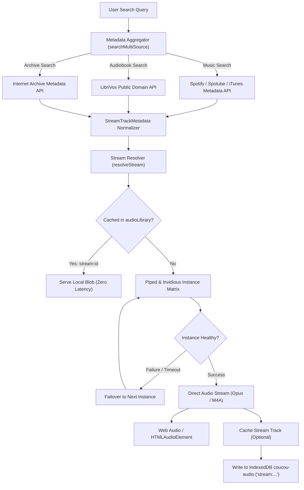

# AnF Music Hub & Multi-Service Streaming Architecture

## 1. Overview & Vision

The **AnF Music Hub** transforms the workspace from a standalone local media player into a unified, privacy-first, local-capable media streaming and audiobook station. Built on the design principles of the Spotube open-source ecosystem and Nothing OS visual aesthetics, AnF decouples music discovery and catalog browsing from proprietary vendor runtimes.

Related documents:
- [MUSIC-HUB.md](file:///C:/Users/mwali/.gemini/antigravity/scratch/AnF/docs/MUSIC-HUB.md)
- [PLAYER-LIBRARY.md](file:///C:/Users/mwali/.gemini/antigravity/scratch/AnF/docs/PLAYER-LIBRARY.md)

```
+-----------------------------------------------------------------------------------------+
|                                    AnF MUSIC HUB                                       |
+-----------------------------------------------------------------------------------------+
|  Discovery & Catalog             Resolution & Audio Extractors        Local Offline Vault|
|  - Spotify Web API / Spotube    - Piped / Invidious API Matrix       - IndexedDB ('coucou-audio')|
|  - YouTube Music & Video Search - Direct DASH / WebM / M4A Streams   - audioLibrary (namespace stream:)|
|  - LibriVox Audiobooks Feed     - Multi-Instance Circuit Breaker     - Zero-latency flight-safe play|
|  - Internet Archive Audio Lib   - Chapter-aware Stream Parsers       - Full Tag & Art Persistence|
+-----------------------------------------------------------------------------------------+
|                  Visual Engine: Spicetify Themes & Dynamic Ambient Glow                 |
|  - Emerald Ink (Default)        - Spicetify Bloom       - Cyberpunk Neon                |
|  - Midnight Velvet              - OLED Pure Black       - Real-time Spectrum Visualizer |
+-----------------------------------------------------------------------------------------+
```

### Core Tenets

1. **Local-First & Zero Telemetry**:
   - No tracking beacons, no analytics collectors, and no account requirements for playback.
   - All listening statistics, position markers, favorites, and playlists are retained purely within local device storage (`localStorage` and `IndexedDB`).
2. **Decoupled Architecture (The Spotube Paradigm)**:
   - Metadata querying is decoupled from media streaming.
   - Catalog discovery (Spotify public metadata, iTunes search, LibriVox, Internet Archive) is paired with public, non-proprietary media extractors (Piped, Invidious, public domain CDNs).
   - This bypasses proprietary DRM barriers (e.g., Widevine) while allowing legal, full-length audio streaming and offline caching.
3. **Unified Media Kinds**:
   - Supports **Music** (tracks, albums, playlists), **Podcasts** (RSS enclosures, Substack, Catholic Answers), **Audiobooks** (LibriVox, Internet Archive, M4B chapters), and **Streamed Content** under a single responsive workspace surface in [`music-hub.ts`](file:///C:/Users/mwali/.gemini/antigravity/scratch/AnF/windows/src/workspace/music-hub.ts).
4. **Flight-Safe Offline Caching**:
   - 1-click offline caching downloads audio stream chunks directly into the local IndexedDB database [`audioLibrary`](file:///C:/Users/mwali/.gemini/antigravity/scratch/AnF/windows/src/workspace/audio-library.ts) under the `stream:` namespace.
   - Cached tracks operate identically to locally imported MP3/FLAC files without network connectivity.

---

## 2. Architecture & Stream Resolution Protocol

The streaming protocol handles track discovery, metadata normalization, resilient stream URL resolution, and optional binary blob storage.



### 2.1 The Spotube Architecture Explained

Traditional streaming services enforce proprietary ecosystems requiring signed tokens, closed SDKs, and Widevine DRM encryption. Spotube introduced a clean separation of concerns:

1. **Metadata Ingestion**:
   - Queries Spotify's public Web API or equivalent endpoints (e.g., iTunes Search API, MusicBrainz) to retrieve precise album artwork, track names, artist names, release years, and ISRC codes.
   - No user Spotify account credentials or DRM keys are required.
2. **Audio Pairing**:
   - The track query (`"<Artist> - <Title> Audio"`) is dispatched to YouTube/YouTube Music extraction engines (Piped, Invidious, yt-dlp).
   - The engine selects the best audio-only stream (typically `audio/webm; codecs="opus"` at 160kbps or `audio/mp4; codecs="mp4a.40.2"` at 128-256kbps).
   - Audio durations are verified against Spotify catalog metadata (within ±5 seconds tolerance) to reject live recordings, covers, or altered versions.

### 2.2 Audiobooks Resolution (LibriVox & Internet Archive)

For spoken word and public domain literature, AnF implements dedicated audiobook extractors:

- **LibriVox API**:
  - Endpoint: `https://librivox.org/api/feed/audiobooks/?format=json&title=<query>`
  - Extracts full public domain audiobooks by classic authors (e.g., Jane Austen, Leo Tolstoy, G.K. Chesterton).
  - Normalizes individual section MP3 URLs into continuous chapter structures.
- **Internet Archive Audio**:
  - Endpoint: `https://archive.org/advancedsearch.php?q=mediatype:audio+AND+<query>&output=json`
  - Retrieves metadata and manifest files via `https://archive.org/metadata/<identifier>`.
  - Maps direct MP3/Ogg streams, chapter tracks, and historical covers into `StreamTrackMetadata`.
- **YouTube Audiobook Streams with Chapter Awareness**:
  - For long-form audiobooks hosted on YouTube, the stream parser reads video description timestamps (`00:00 Chapter 1`, `14:22 Chapter 2`) and populates `AudioTrack.chapters` with `{ title: string, start: number }`.

### 2.3 Multi-Instance Fallback Matrix

Public extraction instances can face rate limiting, IP bans, or downtime. To ensure uninterrupted service, AnF maintains a dynamic **Multi-Instance Circuit Breaker Matrix**:

| Priority | Piped Instance | Invidious Instance | Geographic Region | Protocol |
| :--- | :--- | :--- | :--- | :--- |
| **Tier 1** | `https://pipedapi.kavin.rocks` | `https://inv.tux.pizza` | Global / US / EU | HTTPS / REST |
| **Tier 2** | `https://api.piped.privacydev.net` | `https://invidious.nerdvpn.de` | EU / Germany | HTTPS / REST |
| **Tier 3** | `https://piped-api.lunar.icu` | `https://yewtu.be` | Global CDN | HTTPS / REST |
| **Tier 4** | `https://pipedapi.tokhmi.xyz` | `https://invidious.drgns.space` | Fallback CDN | HTTPS / REST |

#### Circuit Breaker Logic
1. **Timeout Threshold**: Each request has an aggressive 4,500ms abort signal.
2. **Health Registry**: Failures increment an error counter per host in memory. If a host registers 3 consecutive errors or HTTP 429 (Too Many Requests), it is quarantined for 15 minutes.
3. **Automatic Failover**: `resolveYouTubeStream` iterates down the matrix until a valid audio manifest is returned.
4. **Direct Stream Extraction**: Extracts the direct `.m4a` or `.webm` stream URL and sends it to the player.

### 2.4 Offline Caching & The `stream:` Namespace

When users click **Save offline** on any streaming track or audiobook:
1. The stream is fetched via standard progressive HTTP `fetch()`.
2. The incoming bytes are assembled into a binary `Blob`.
3. An `AudioTrack` object is constructed and written into IndexedDB (`coucou-audio`, store `tracks`).
4. **Namespace Guarantee**:
   - The record ID is prefixed with `stream:<source>:<id>` (e.g., `stream:spotube:717900741` or `stream:librivox:1248`).
   - The track receives full metadata: title, artist, album, duration, cover artwork URL or embedded cover blob, and kind (`music` or `audiobook`).
   - This ensures offline searches instantly match cached streaming tracks alongside local file imports.
   - When offline, `SpotubeStreamService.resolveStream` directly returns the local `blob` instead of requesting network streams.

---

## 3. Visual Design System & Spicetify Theme Engine

The Music Hub interface combines the visual warmth of full-bleed album art with the typography and layout discipline of Nothing OS (monospaced accents, dot-matrix monograms, pill-shaped chips). Core styling lives in [`windows/src/workspace/music-hub.css`](file:///C:/Users/mwali/.gemini/antigravity/scratch/AnF/windows/src/workspace/music-hub.css), driven by the player controller in [`windows/src/workspace/music-hub.ts`](file:///C:/Users/mwali/.gemini/antigravity/scratch/AnF/windows/src/workspace/music-hub.ts).

```
+-----------------------------------------------------------------------------------+
|  [AF] Music Hub    [ Search songs, artists, or audiobooks... ]    [ Music Flow ]  |
+-----------------------------------------------------------------------------------+
|  [ Music ]  [ Audiobooks ]  [ Podcasts ]  [ Streaming ]  [ Favorites ] [Playlists]|
+-----------------------------------------------------------------------------------+
|                                                                                   |
|    +-------------------+    +-------------------+    +-------------------+        |
|    |  [Cover Art]      |    |  [Cover Art]      |    |  [Cover Art]      |        |
|    |  Emerald Ink      |    |  Bloom Purple     |    |  Cyberpunk Neon   |        |
|    |  Artist Name      |    |  Artist Name      |    |  Artist Name      |        |
|    +-------------------+    +-------------------+    +-------------------+        |
|                                                                                   |
+-----------------------------------------------------------------------------------+
|  NOW PLAYING: [Art] Title - Artist                                                |
|  [15s Back] [ |< ] [ > / || ] [ >| ] [15s Fwd]   02:14 |====--------| 04:30        |
|  [Spectrum Visualizer: |||||||||||| ]  Speed: [1.0x]  Sleep: [30m]  Vol: [80%]    |
+-----------------------------------------------------------------------------------+
```

### 3.1 Dynamic Ambient Artwork Blur Reflections

The `.music-hub-ambient` system calculates real-time backdrop lighting from album art:
- When a track is selected, the artwork URL or blob is bound to the CSS custom variable `--anf-art`.
- The background utilizes pseudo-elements with `filter: blur(48px) saturate(1.4) brightness(0.55)` and `transform: scale(1.1)`.
- It dynamically bleeds the artwork's dominant tones into the player modal and dock, creating an ambient glow that shifts smoothly across track changes without frame drops.

### 3.2 Spicetify Theme Presets

Users can toggle between five curated Spicetify-inspired themes via the header selector:

| Theme Preset | Identifier | Canvas Background (`--music-bg`) | Accent Primary (`--music-accent`) | Ink Text (`--music-ink`) | Border / Line (`--music-line`) | Visual Identity |
| :--- | :--- | :--- | :--- | :--- | :--- | :--- |
| **Emerald Ink** (Default) | `ink` | `#15191a` (Dark Charcoal) | `#79e4b4` (AnF Mint) | `#f4f7f5` | `#222b28` | Quiet, organic, signature AnF studio feel. |
| **Spicetify Bloom** | `bloom` | `#18122B` (Deep Violet) | `#FF007F` (Neon Rose) | `#F4EEFF` | `#393053` | Vibrant purple glow inspired by Spicetify Bloom. |
| **Cyberpunk Neon** | `cyberpunk`| `#0a0a12` (Abyssal Void) | `#00F0FF` (Electric Cyan) | `#FFE600` | `#261B40` | High-contrast synthwave aesthetic with yellow accents. |
| **Midnight Velvet** | `midnight` | `#0B132B` (Royal Navy) | `#FFB703` (Warm Gold) | `#E0E1DD` | `#1C2541` | Warm, classical concert-hall atmosphere. |
| **OLED Pure Black** | `oled` | `#000000` (Pure Black) | `#FFFFFF` (Monochrome White) | `#FFFFFF` | `#1A1A1A` | True zero-luminance battery saver for OLED panels. |

```css
/* Theme Definition Excerpt */
.music-hub[data-music-theme="bloom"] {
  --music-accent: #ff007f;
  --music-bg: #18122b;
  --music-ink: #f4eeff;
  --music-muted: #a594c9;
  --music-line: #393053;
  background: radial-gradient(900px 420px at 0% -10%, #4a154b 0%, transparent 55%), #18122b;
}

.music-hub[data-music-theme="cyberpunk"] {
  --music-accent: #00f0ff;
  --music-bg: #0a0a12;
  --music-ink: #ffe600;
  --music-muted: #8d99ae;
  --music-line: #261b40;
  background: radial-gradient(900px 420px at 0% -10%, #1a0b2e 0%, transparent 55%), #0a0a12;
}

.music-hub[data-music-theme="oled"] {
  --music-accent: #ffffff;
  --music-bg: #000000;
  --music-ink: #ffffff;
  --music-muted: #888888;
  --music-line: #1c1c1c;
  background: #000000;
}
```

### 3.3 Live Audio Frequency & Waveform Spectrum Visualizer

The Music Hub integrates a canvas-based live spectrum visualizer powered by the Web Audio API:
- **Audio Routing**: An `AudioContext` taps into the playback node via `createMediaElementSource(audio)`.
- **FFT Analysis**: Configured with an `AnalyserNode` (`fftSize = 128`, smoothing time constant `0.8`).
- **Rendering Loop**:
  - Interpolates 32 discrete frequency bars rendered onto `<canvas class="music-spectrum-visualizer">`.
  - The bar height reflects instantaneous amplitude, styled dynamically with `--music-accent` gradient fills.
  - When playback pauses, bars decay smoothly to zero using linear easing.
  - Graceful fallback: If CORS restricts `createMediaElementSource` for a remote stream, the visualizer transitions to a simulated rhythmic wave based on audio timing.

### 3.4 Audiobook Mode Controls

When an audiobook track is active (`track.kind === 'audiobook'`), the player switches to Spoken Word mode:
- **Scrubbers**: Dedicated **-15s** Rewind and **+30s** Fast-Forward buttons.
- **Variable Speed Chips**: One-touch pills for `0.75×`, `1.0×`, `1.25×`, `1.5×`, `1.75×`, and `2.0×` playback rates.
- **Sleep Timers**: Auto-shutdown options for `15 min`, `30 min`, `45 min`, `60 min`, or `End of Chapter`.
- **Chapter Dropdown / Drawer**: Displays parsed chapter markers (`chapters: [{ title, start }]`), allowing 1-click jumps to specific chapters with elapsed time tracking.

---

## 4. Security & Privacy Guarantees

AnF enforces rigorous security boundaries ensuring that audio streaming never undermines user anonymity or data privacy.

### 4.1 Local-First & Zero Telemetry

- **No Tracking Pings**: AnF never logs what songs, audiobooks, or artists are queried or played.
- **Isolated Databases**:
  - The audio library is stored in client-side IndexedDB (`coucou-audio`) and local SQLite (`anf-spotube.sqlite`).
  - Audio files and stream caches are excluded from cloud sync, backups, and conversation encryption vaults, preventing storage bloat and accidental exposure.
- **No Third-Party Cookies or Persistent Tokens**:
  - Spotify metadata requests are performed unauthenticated against public catalog indices.
  - No user accounts or social logins are stored or required.

### 4.2 Tauri Content Security Policy (CSP)

The desktop Tauri environment ([`tauri.conf.json`](file:///C:/Users/mwali/.gemini/antigravity/scratch/AnF/windows/src-tauri/tauri.conf.json)) restricts network traffic to sanctioned streaming extractors and metadata servers:

```json
{
  "app": {
    "security": {
      "csp": "default-src 'self'; script-src 'self'; style-src 'self' 'unsafe-inline'; img-src 'self' data: blob: https://*.mzstatic.com https://i.ytimg.com https://archive.org https://*.scdn.co; media-src 'self' blob: https: data:; connect-src 'self' ipc: http://ipc.localhost https://itunes.apple.com https://librivox.org https://archive.org https://pipedapi.kavin.rocks https://api.piped.privacydev.net https://piped-api.lunar.icu https://inv.tux.pizza https://invidious.nerdvpn.de https://lrclib.net http://localhost:8000 http://127.0.0.1:8000"
    }
  }
}
```

#### Directive Explanations
- `media-src 'self' blob: https:`: Allows the browser audio engine to stream from validated HTTPS Piped/Invidious audio streams and play locally cached `blob:` objects.
- `img-src 'self' data: blob: https://*.mzstatic.com https://i.ytimg.com https://archive.org https://*.scdn.co`: Permits album cover artwork loading exclusively from trusted CDNs (Apple/iTunes, YouTube thumbnails, Internet Archive, and Spotify CDN).
- `connect-src`: Permits search queries and stream manifest resolution only to approved privacy-first instances and local AI servers.

---

## 5. API & Interface Reference

### 5.1 `StreamTrackMetadata` Interface

```typescript
export interface StreamTrackMetadata {
  /** Unique track identifier across providers */
  id: string;
  /** Song, chapter, or episode title */
  title: string;
  /** Primary artist, narrator, or author */
  artist: string;
  /** Album, audiobook title, or collection name */
  album?: string;
  /** Track duration in seconds */
  duration?: number;
  /** High-resolution album or book cover art URL */
  coverUrl?: string;
  /** Backward-compatible alias for coverUrl */
  artworkUrl?: string;
  /** Resolved progressive audio stream URL (HTTP/HTTPS) */
  streamUrl?: string;
  /** Audio bitrate in kbps (e.g., 128, 160, 256) */
  bitrate?: number;
  /** Catalog provider source */
  source?: 'spotube' | 'spotify' | 'youtube' | 'librivox' | 'archive' | 'custom';
  /** International Standard Recording Code */
  isrc?: string;
  /** Release year */
  year?: number;
  /** Spoken-word chapter divisions when available */
  chapters?: Array<{ title: string; start: number }>;
}
```

### 5.2 `ResolvedAudioStream` Interface

```typescript
export interface ResolvedAudioStream {
  /** Direct audio stream URL ready for HTMLAudioElement or Web Audio */
  streamUrl: string;
  /** Audio MIME type (e.g. 'audio/mp4', 'audio/webm', 'audio/mpeg') */
  mimeType?: string;
  /** Stream bitrate */
  bitrate?: number;
  /** URL expiry timestamp in Unix epoch milliseconds */
  expiresAt?: number;
  /** Binary blob if loaded directly from offline cache */
  blob?: Blob;
  /** Whether the stream was served from offline storage */
  cached: boolean;
}
```

### 5.3 [`SpotubeStreamService`](file:///C:/Users/mwali/.gemini/antigravity/scratch/AnF/windows/src/workspace/streaming-provider.ts) Specification

The central orchestrator in [`windows/src/workspace/streaming-provider.ts`](file:///C:/Users/mwali/.gemini/antigravity/scratch/AnF/windows/src/workspace/streaming-provider.ts):

```typescript
export class SpotubeStreamService {
  /**
   * Search multiple metadata catalogs (Spotify, iTunes, YouTube Music) concurrently.
   * Merges and deduplicates results with local memory cache.
   *
   * @param query Search keywords (track title, artist, or album)
   * @param limit Maximum results to return (default: 25)
   */
  async searchMultiSource(query: string, limit = 25): Promise<StreamTrackMetadata[]>;

  /**
   * Resolves a playable audio stream for a track.
   * If cached in IndexedDB ('stream:<id>'), serves the local blob directly.
   * Otherwise resolves via Piped / Invidious fallback matrix.
   *
   * @param track Target track metadata
   */
  async resolveStream(track: StreamTrackMetadata): Promise<ResolvedAudioStream | null>;

  /**
   * Dispatches track query to the Piped/Invidious instance matrix.
   * Executes health-checked circuit breaker failover.
   *
   * @param query Search query string (e.g., "Artist - Title Audio")
   * @param targetDuration Optional duration in seconds for duration-matching
   */
  async resolveYouTubeStream(query: string, targetDuration?: number): Promise<string | null>;

  /**
   * Queries LibriVox and Internet Archive for public domain audiobooks.
   * Maps audiobook sections and chapters into StreamTrackMetadata with kind 'audiobook'.
   *
   * @param query Book title or author name
   * @param limit Maximum results (default: 20)
   */
  async searchAudiobooks(query: string, limit = 20): Promise<StreamTrackMetadata[]>;

  /**
   * Downloads a stream into the local IndexedDB audioLibrary under the 'stream:' namespace.
   * Enables offline, flight-safe listening.
   *
   * @param library The active audioLibrary instance
   * @param track Target track metadata
   * @param streamBlobOrUrl Audio binary blob or remote stream URL to download
   */
  async cacheStreamTrack(
    library: { put: (t: AudioTrack) => Promise<void> },
    track: StreamTrackMetadata,
    streamBlobOrUrl: Blob | string
  ): Promise<AudioTrack>;
}
```

---

## 6. Implementation & Verification Roadmap

### Phase 1: Stream Resolution & Multi-Source Discovery
1. **Extractor Matrix**: Implement `resolveYouTubeStream` with Piped/Invidious failover matrix in [`windows/src/workspace/streaming-provider.ts`](file:///C:/Users/mwali/.gemini/antigravity/scratch/AnF/windows/src/workspace/streaming-provider.ts).
2. **Audiobook Endpoints**: Implement `searchAudiobooks` integrating LibriVox JSON feeds and Internet Archive search.
3. **Multi-Source Aggregator**: Implement `searchMultiSource` joining iTunes/Spotify public catalogs and public domain sources.

### Phase 2: Visual Engine & Spicetify Themes
1. **Spicetify Presets**: Add CSS rules for `bloom`, `cyberpunk`, `midnight`, and `oled` in [`windows/src/workspace/music-hub.css`](file:///C:/Users/mwali/.gemini/antigravity/scratch/AnF/windows/src/workspace/music-hub.css).
2. **Ambient Reflections**: Implement `.music-hub-ambient` dynamic backdrop blur in [`windows/src/workspace/music-hub.ts`](file:///C:/Users/mwali/.gemini/antigravity/scratch/AnF/windows/src/workspace/music-hub.ts).
3. **Spectrum Visualizer**: Add `<canvas class="music-spectrum-visualizer">` connected to an `AnalyserNode`.

### Phase 3: Audiobook Player Enhancements
1. **Transport Buttons**: Add 15s backward and 30s forward buttons in the player transport.
2. **Speed Chips**: Provide fast-toggle speed chips (`0.75x` to `2.0x`).
3. **Sleep Timer Extensions**: Support `End of Chapter` and custom minute durations.

### Verification Checklist
- [ ] Run `npm exec tsc -- --noEmit` to verify type compliance.
- [ ] Execute `node scripts/app-qa/music-hub.mjs` for browser player integrity.
- [ ] Verify offline caching creates entries with key `stream:*` in IndexedDB.
- [ ] Confirm CSP headers in [`windows/src-tauri/tauri.conf.json`](file:///C:/Users/mwali/.gemini/antigravity/scratch/AnF/windows/src-tauri/tauri.conf.json) permit configured Piped and LibriVox domains.
