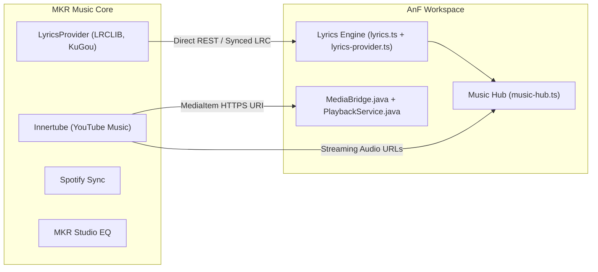

# MKR Music Integration for AnF

This directory contains the integration bridge and build recipes for **MKR Music** (`mkr-music`), developed by [@mkr-infinity](https://github.com/mkr-infinity/mkr-music).

---

## 🎧 About MKR Music

MKR Music is a premier open-source audio streaming, playback, and lyrics platform. It unifies:
1. **Tri-Engine Streaming**: High-quality audio extraction from YouTube Music (`innertube`), JioSaavn, and Spotify playlist synchronization.
2. **Synchronized Lyrics Engine**: Multi-provider lyrics aggregator with word-by-word and line-by-line synced scrolling (LRCLIB, KuGou, Paxsenix, Unison, and YouLyPlus).
3. **MKR Studio Equalizer**: 10-band precision equalization, Dolby Atmos simulation, and acoustic profiles.
4. **Smart Mood Queuing & Instant Cache**: Buffer-free streaming with local caching.

---

## 🏗️ Architecture in AnF

MKR Music connects into AnF across both the **Desktop Workspace** (Windows & Linux Tauri) and the **Android Native Workspace**:

---

## 📜 Licensing & Acknowledgements

MKR Music is licensed under the **GNU General Public License v3.0 (GPLv3)**.
Source repository: [https://github.com/mkr-infinity/mkr-music](https://github.com/mkr-infinity/mkr-music)
Author: `@mkr-infinity`

In accordance with GPLv3:
- AnF maintains complete attribution and source references.
- Integration scripts and modules remain fully transparent and open source.
