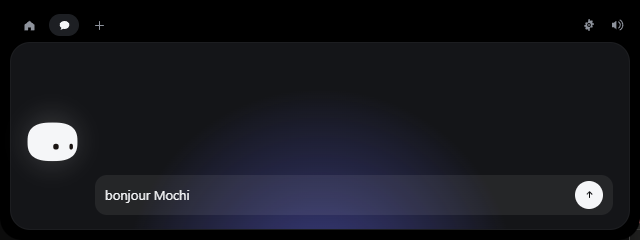
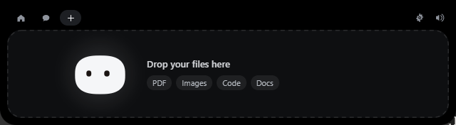

<div align="center">


# AnF for Windows

**Mochi doesn't get a notch on a PC — so it lives at the top of your screen instead.**

Approve Claude Code permissions, watch your session work, drop a file, chat with Claude, keep an eye on your services — without leaving what you're doing.


</div>


---

## Install

The downloadable installer is **temporarily unavailable**. Microsoft Defender
wrongly flags the unsigned installer as malware (`Trojan:Win32/Wacatac.H!ml`, a
machine-learning false positive). A report is under review at Microsoft, and the
installer will be published again once it is cleared and code-signed.

Until then, [build it yourself](#build-it-yourself): it takes a few minutes and
installs for the current user only — no admin prompt.

## Using it

### Personal Windows build: multiple AI providers and offline chat

Settings > AI chat offers chat inside AnF or a browser handoff to your existing
Claude, ChatGPT, Gemini, and Gemini Notebook accounts. Browser mode copies the
question and opens the website; you paste and send it there. Website answers and
notebooks are not imported, and files must be attached on the website.

Chat inside AnF supports Anthropic Messages, OpenAI Responses, Gemini
generateContent, and a bundled offline Qwen3 1.7B model. The three cloud providers
need their own API keys, stored in Windows Credential Manager. The offline model
needs no key, subscription, or internet and is the default for a new setup.

Offline fallback is enabled by default for missing keys, authentication/quota
errors, service outages, and connection failures. A fresh local conversation
begins and continues locally until you reset the chat or change its provider or
model. It does not route around content refusals. Every local reply is labelled.
The small local model reads text, has no web search, and is less capable than the
cloud models. Its context is finite: old turns or oversized inputs are shortened
with a visible notice. Replies that reach the output limit can be continued.
Website subscriptions and provider quotas remain subject to their own limits.

For source builds on Windows, run `scripts/prepare-offline.ps1` before a normal
Tauri build. It downloads pinned official llama.cpp and Qwen assets, verifies the
binary/model SHA-256 values, and extracts the runtime. The full installer includes
these components. Portable use requires `local-ai` beside `AnF.exe`; copying
only the small executable does not carry the model with it. The source archive
contains the download recipe, not the model weights. See the included component
licenses and notices.





| What you do | What happens |
|---|---|
| Move the mouse to the very top-centre of the screen | Mochi peeks out |
| Click the small island | It opens |
| Click Mochi | It gets annoyed. Three times in a row and it goes dizzy |
| Rest the pointer on Mochi for two seconds | Hearts |
| Drag a file onto the island | Mochi turns into a box, swallows it, then offers to answer questions about it |
| `Esc` | Closes the island |
| Tray icon | Open, Settings…, Pause, Quit |

Everything else happens on its own: a Claude Code permission request opens the
island with **Deny / Allow**, a finished session shows what it did, and
your integrations sit in the coloured pills next to Mochi.

## Claude Code


Open **Settings… → Claude Code → Install hooks…**. You get the exact diff of what
will change in `%USERPROFILE%\.claude\settings.json`, the path of the dated backup
that will be taken, and nothing is written until you click. Your own hooks are
never touched, and uninstalling removes only AnF's entries.

The relay is a tiny executable, `coucou-hook.exe`, copied to
`%LOCALAPPDATA%\Coucou\bin\` at launch. It is given 300 ms to reach AnF and
exits cleanly if the app is closed, slow or crashed — **a Claude Code session is
never blocked or slowed down by AnF.** If nobody answers a permission request
in time, AnF stays quiet and Claude Code asks in the terminal as usual.

It works from any terminal — Windows Terminal, PowerShell, VS Code, Git Bash.

## Chat and keys

**Settings… → Claude** takes your Anthropic API key. Keys live in the **Windows
Credential Manager**, never on disk and never in the interface — the island can
only ask whether a key exists. Same for every integration key.

No telemetry. The only network requests AnF makes are to the services you
configure yourself.

## Build it yourself

You need [Rust](https://rustup.rs), [Node 20+](https://nodejs.org), and the
**MSVC build tools** (Visual Studio Build Tools with "Desktop development with
C++"). WebView2 ships with Windows 10/11.

```powershell
cd windows
npm install
npm run tauri dev      # live-reloading development build
npm run pack           # builds the installer and drops it in windows/release/
```

`npm run dev` alone serves the front end in an ordinary browser, which is enough
to work on the island's looks. It also serves `dev/upload-preview.html`, which
replays the whole file-drop choreography on a loop — the one part of the UI that
otherwise needs a real drag from Explorer to see. Neither page ships in the app.

`npm run pack` leaves two files in `windows/release/`, the same names the release
workflow publishes:

```
AnF-Windows-X.Y.Z-setup.exe    the versioned installer
AnF-Windows-setup.exe          the same file under the rolling name
```

Installing is optional — `target/release/coucou.exe` runs on its own. There is no
window in the taskbar and no console: the island at the top of the screen and the
Mochi in the notification area are the whole app, and Quit lives in its menu.

The 28 sounds are the macOS app's own files; they are never duplicated in this
folder. The path is declared once, in `SOUNDS_DIR` at the top of
`vite.config.ts` — when they move to `shared/sounds/`, change that one line.

The app icon and the tray icon are drawn in code, like Mochi itself:

```powershell
npm run icons          # regenerates src-tauri/icons from scripts/gen-icons.mjs
```

### Layout

```
windows/
  src/                 island front end (TypeScript, no framework)
    mochi/             Mochi and the launch greeting, in Canvas 2D
    island/            state machine, hooks, integrations
    views/             every island view
    settings/          the settings window
  src-tauri/           Rust backend: window, named pipe, Claude API, pollers
  hook/                coucou-hook.exe, the Claude Code relay
  scripts/             icon generator
```

### Log

`%LOCALAPPDATA%\AnF\coucou.log` — hook events, permission decisions, poller
problems. It stays on your machine.

## What's different from the Mac version

- No notch, so the island lives at the top centre of the screen and retracts into
  the top edge instead of hiding in a notch.
- Permission approval works from **any** terminal; the Mac build only listens to
  VS Code sessions.
- Not in this version: sending a file by email, dragging Mochi onto a window to
  attach it as context, and jumping to a specific terminal window — "Open
  terminal" opens the working folder in VS Code when `code` is on your `PATH`.
- Cal.com shows the next bookings as a list rather than the Mac's calendar.

## Linux

The same app builds for Linux: everything that differs lives in
`src-tauri/src/platform/`, and the relay's transport in `hook/src/unix.rs`.

```bash
sudo apt install build-essential pkg-config \
  libwebkit2gtk-4.1-dev libgtk-layer-shell-dev libayatana-appindicator3-dev \
  librsvg2-dev libssl-dev libdbus-1-dev patchelf \
  gstreamer1.0-plugins-base gstreamer1.0-plugins-good
npm install
npm run tauri dev      # live-reloading development build
npm run pack           # AppImage, .deb and .rpm in windows/release/
```

What changes on Linux:

- **The island** is a gtk-layer-shell overlay anchored to the top edge, over any
  top panel, on compositors that support it: COSMIC, KDE Plasma, Hyprland, Sway
  and other wlroots compositors. GNOME has no layer-shell, so there the island
  is a regular window. `COUCOU_LAYER_SHELL=0` forces that mode anywhere.
- **Click-through** is the window's input region, kept equal to the island
  shape, so the compositor sends every other click to what is underneath.
- **Mochi's eyes** follow the pointer only while it is over the island: Wayland
  gives no app the cursor position anywhere else.
- **Claude Code hooks** go through `~/.local/share/coucou/bin/coucou-hook` and a
  Unix socket at `$XDG_RUNTIME_DIR/coucou.sock`. Both ends check that the other
  runs as the same user.
- **Keys** live in the Secret Service (GNOME Keyring, KWallet).
- **Files**: preferences in `~/.config/coucou/`, the log at
  `~/.local/share/coucou/coucou.log`.
- What the Windows build leaves out, this one does too: sending a file by
  email, dragging Mochi onto a window, and jumping to a specific terminal
  window — "Open terminal" opens the folder in VS Code.

## Key-free workspace (0.1.4)

The workspace opens first on Windows. Settings and the island use the same WebView2 profile and browser options. A second launch reopens the workspace. Startup stages are logged in %LOCALAPPDATA%\AnF\coucou.log; initialization errors display a native Windows error message. WebView2 Runtime is required. This release uses a new WebView2 profile and preserves older profiles and preferences.

The workspace always uses local AI, regardless of optional cloud settings. The full installer and portable folder contain two CPU models: Fast (official Qwen3 0.6B Q8_0, about 639 MB on disk) and Balanced (Qwen3 1.7B requantized from Q8_0 to Q4_K_M, about 1.11 GB on disk). Plan roughly 1–2 GB free RAM for Fast or 2–3 GB for Balanced; usage varies with context and runtime overhead. Only one model loads at a time. Model switching unloads the old model. Changing workspace models does not alter cloud credentials. There is no recurring hosted quota, but finite RAM, context, output length, CPU speed and model capability apply. Cloud and browser services retain their own limits.

Projects autosave locally with complete conversation history, editable drafts, source text, model choice and editable memory. Reopen any saved project; the most recent one reopens at startup. Each successful save is a new atomic snapshot; the previous three versions are retained, and loading falls back to an earlier valid save if the newest is damaged. Project files live in %LOCALAPPDATA%\AnF\projects and are private to the Windows account but not encrypted. No credential fields are stored in project snapshots. Limits: four sources, 1,000 conversation messages and 16 MB per project; start another project when full. Recent model context is bounded independently of the full saved history. Memory refreshes after every five exchanges; you can also summarize manually or edit it. Summaries may omit facts, so saved full history remains available. The workspace history sidebar lets you search saved project names and reopen full conversations.

Load PDFs, UTF-8 text, PNG or JPEG files (20 MB each, 2 MB extracted text per document, at most 600 PDF pages). Selectable PDF text is read page by page; pages with little or no embedded text are rendered using Windows Data.Pdf and processed by bundled Ocrs models. Clear English and Latin-alphabet text work best; OCR errors are possible. Ocrs cannot reliably recognize every language or handwriting. Source copies are retained under AnF's sources folder so saved projects do not depend on the seven-day temporary inbox. There is no OCR download or cloud request at runtime.

The floating chat can attach PDF, text, CSV, JSON, log, PNG or JPEG files up to 12 MB, including during an ongoing conversation. The workspace exports editable writing as Word, plain text, Markdown, HTML and RTF; use Print to PDF to create a PDF with Windows' print dialog. Read-aloud uses installed Windows voices. Audio tools filter low rumble and soften loudness dynamics in a selected recording before downloading a WAV copy; offline transcription and voice cloning require speech models that are not bundled. The clarity action improves readability while preserving meaning and does not promise to influence AI-detector results.

Every question retrieves page-aware excerpts from the sources. Rare query words receive extra weight. Generic summaries sample beginning, middle and end; comparing sources includes evidence from each. The reply shows the actual excerpts and page numbers used, and the model is asked to cite [1], [2], etc. Citations remain model output and require checking. This is selected-excerpt analysis rather than exhaustive review of every page. You can expand a loaded source to read all extracted text.

Task buttons summarize a PDF, draft a letter, compare documents and explain a webpage. Progress shows elapsed time. Cancel stops local inference and ignores late results; document reading checks cancellation between pages. A single OCR page finishes its current native rendering/inference before stopping. The island and workspace share the local runtime, so cancellation can interrupt another local chat using that runtime. Writing/applying actions cannot be cancelled once started, and their controls do not offer Cancel.

File actions require an exact preview followed by an explicit Apply click. Create a new folder, open a document in its default Windows app, save and open the current draft in Notepad, or organize selected documents into a new folder grouped by type. Organizing makes copies and preserves original files; nothing is overwritten. Previews expire after five minutes, can only be applied once, and copying checks source fingerprints. Editing a destination or draft invalidates the preview. Programs, scripts and shortcut files are excluded from document-open actions. No model-generated commands or arbitrary code are executed.

Public webpage reading supports HTTPS articles and text pages, with public-address validation. Login pages, redirects and JavaScript-dependent websites need the browser. Website requests disclose the requested URL and your internet address to that website. The workspace does not send documents to a cloud API. Optional website launchers and cloud accounts remain available; account setup, service charges and limits apply. Credential integrations and coding hooks are inside the collapsed Advanced section of Settings.

### Build and verification

Run scripts/prepare-offline.ps1 before packaging to download pinned, verified runtime/model files and produce the smaller Balanced weights. The original Balanced source weights are a build input and are not bundled. Resource rules explicitly include the two ready model files and OCR models. Third-party license notices accompany the runtime, weights and compiled Rust dependencies. The NSIS bundle uses zlib compression to accommodate the two bundled models within NSIS size limits.

Native tests cover PDF extraction, page-aware retrieval, project recovery, preview/apply rules and cancellation. Ignored live tests run both bundled models, local PDF-to-Word drafting, scanned-PDF OCR and public webpage reading. Frontend flow checks: build assets, then run node dev/workspace-check.cjs from windows/. These exercise saves, memory refresh, local defaults, preview invalidation and stale reply cancellation using a DOM and IPC test double; they are not a live Windows UI test.

## Repair update (0.1.5)

Install over the existing AnF installation using the same folder; manual
uninstallation is unnecessary. The package keeps the existing application identity.
Installer hooks check the installed app and local engine with Windows Restart
Manager before replacement, and preserve user documents, projects, inbox and settings.
The application retries offline-pack discovery when local AI is used, including after
an installer repairs files while an older instance had cached a missing pack.

The floating panel now offers 3s and 5s auto-close presets alongside 10s, 15s and 30s.
The full Settings input accepts 3–120 seconds. These control expanded-panel collapse
on mouse leave; hovering cancels the timer and pinned decision prompts stay open.
Run `node dev/timing-check.cjs` from `windows` for timer regression checks.

## Local device connection (0.1.11)

Windows Settings offers an explicit private-IP listener and optional phone access
 to the Fast offline model. Android Settings pairs using the per-session code;
Sync now exchanges saved projects, with extracted documents excluded by default.
AES-256-GCM authenticates application payloads over private-LAN HTTP. No cloud
relay, persistent pairing key, automatic firewall rule or public listener is used.
Request/response AAD binds the route and request nonce; authenticated replayed
requests are rejected. Only two simultaneous connections and bounded messages
are accepted. Stop sharing revokes the session, including pending AI responses.

Project revisions support conservative conflict copies, idempotent transfer
retries and stale Windows editor detection. Device file paths are never exported.
Reopen Windows history after syncing; the UI does not silently reload an active
editor. Mobile unfinished pasted replies remain local. Sync is manual, not backup.

See outputs/Read-me-Workspace-0.1.11.txt in the build workspace for setup and limits.
Native tests exercise transport/authentication and conflict handling. The optional
java_transport_interoperates test runs android/java-test/.../LinkCheck.java using
COUCOU_TEST_JAVA and COUCOU_TEST_CLASSES. Android sync-check.cjs tests conversion,
metadata, byte bounds and document opt-out against a bundled web/sync.ts module.
Physical phone/tablet network testing remains separate from these checks.


### AnF branding and existing installations

AnF 0.1.20 introduces a shared Android/Windows design with light, dark and system themes. New installers, shortcuts, exports and app icons use AnF. Internal package identifiers, database names, OS credential-store services, browser storage and encrypted-backup authentication remain stable so existing saved work is readable. Older `.coucoupack` backups remain supported; new encrypted exports use `.anfpack`.

The Windows NSIS template is based on Tauri CLI 2.12.0 (MIT/Apache-2.0). It keeps the previous uninstall registry key and installation-location record, and retains the default `%LOCALAPPDATA%\Coucou` folder. The displayed product and executable are AnF; updates find the existing folder automatically. Keep these compatibility changes when updating the upstream installer template. Windows publication remains paused pending signing or Defender clearance.

For rendered interface checks, build the Windows frontend and Android assets, then run `node scripts/app-qa/appearance.mjs` from the repository root with Chromium available. This checks real browser rendering and Android browser storage; native installed-app tests run separately in the release workflows.
